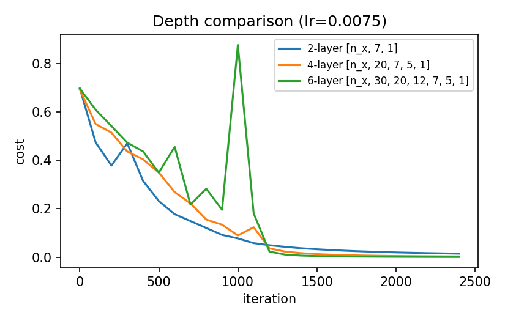
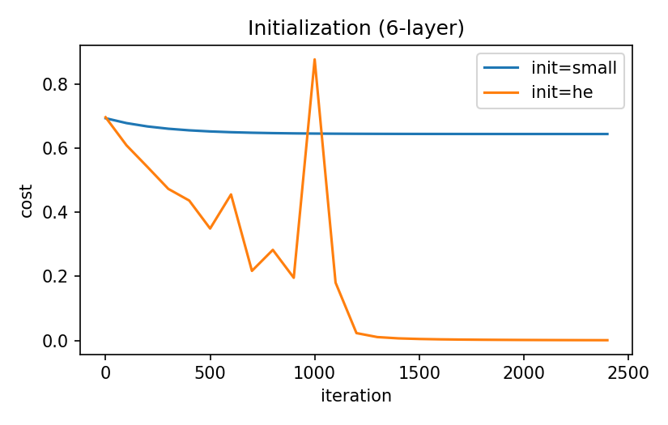

# Deep neural network from scratch (NumPy)

L-layer fully connected network `[LINEAR -> RELU] * (L-1) -> LINEAR -> SIGMOID` for binary
image classification (cat vs non-cat). Initialization, forward and backward propagation,
cost and gradient descent are written by hand.

## What is inside

| File | Purpose |
|---|---|
| `model.py` | initialization (small / He), forward and backward propagation, cost, update, `DeepNetwork` |
| `data.py` | dataset loaders and preprocessing |
| `test_model.py` | basic L-layer net tests |
| `deep_network.ipynb` | experiments: depth comparison, initialization, error analysis |
| `../assets/` | plots used below |

## Run

The experiments were run in Google Colab; the code is developed locally and pulled into Colab.

```python
# first cell in Colab
!git clone https://github.com/nyawmolny/deep-learning-fundamentals.git
%cd deep-learning-fundamentals/01-foundations/deep-network/numpy
```

Data: set `DATA_SOURCE` in the notebook to `"h5"` (put the files in `data/`, not
tracked by git) or `"cifar10"` (downloaded automatically).

### Locally

From this directory:

```bash
pip install -r requirements.txt
pytest
jupyter notebook deep_network.ipynb
```

## Results

### Depth (all with He init)

| Model | Train acc. | Test acc. |
|---|---|---|
| 2-layer `[n_x, 7, 1]` | 100.0% | 72.0% |
| 4-layer `[n_x, 20, 7, 5, 1]` | 100.0% | 74.0% |
| 6-layer `[n_x, 30, 20, 12, 7, 5, 1]` | 100.0% | 76.0% |

### Initialization (6-layer)

| Init | Final cost | Train acc. | Test acc. |
|---|---|---|---|
| N(0, 0.01²) | 0.6440 | 65.6% | 34.0% |
| He | 0.0013 | 100.0% | 76.0% |




## Takeaways

- **Depth vs accuracy:** all configurations reach 100% train accuracy, and test accuracy is
  72-76% (72% → 74% → 76% for 2, 4 and 6 layers). With only 50 test images one image
  equals 2 pp, so these differences are within noise and I cannot claim that depth helps
  here. The 6-layer cost curve shows a visible spike around iteration ~1000, possibly
  training instability. The train/test gap is large at every depth (24-28 pp), which
  suggests the limiting factor is the small training set (209 images) rather than model
  capacity.

- **Why small initialization slows down or stalls training in a deeper network:** with `init=small` (std = 0.01), signal variance shrinks exponentially through the layers — the vanishing-gradient problem. Weights barely update, the cost plateaus at 0.64, and the model stays at chance level (test 34%). He initialization (std = √(2/n_in)) preserves signal variance across layers, cost drops to 0.0013, and the model reaches 76% test. In short: initialization directly determines whether signal/gradients survive propagation through depth — for ReLU networks He-init is the correct choice.
