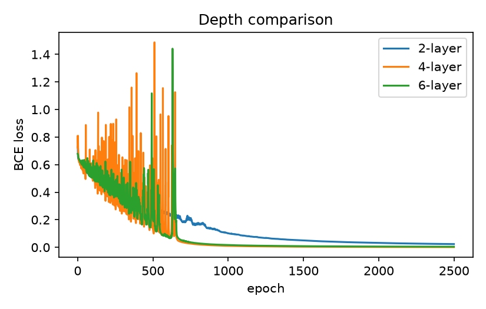
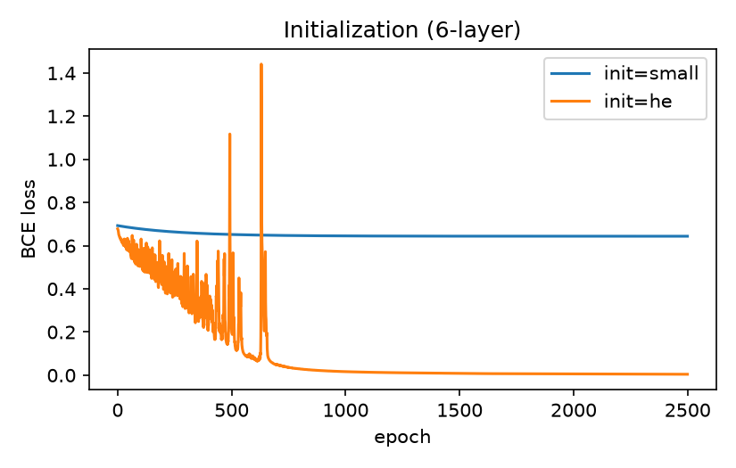

# Deep neural network in PyTorch

The L-layer ReLU network from the NumPy lab rebuilt with `nn.Sequential`. One class covers any
depth: `[n_x, 4, 1]` is a shallow network, `[n_x, 20, 7, 5, 1]` a deep one. The model returns
logits and is trained with `BCEWithLogitsLoss` (for numerical stability).

## What is inside

| File | Purpose |
|---|---|
| `model.py` | `DeepNetworkTorch` (He / small init), training loop, evaluation, loader for the NumPy reference |
| `data.py` | dataset loaders, preprocessing, tensor conversion |
| `test_data.py` | preprocessing tests |
| `test_model.py` | architecture and init tests; **forward, gradient and training equivalence with the NumPy implementation** |
| `deep_network_pytorch.ipynb` | experiments: verification, depth, initialization |
| `../assets/` | plots used below |

## Run

### Google Colab

```python
!git clone https://github.com/nyawmolny/deep-learning-fundamentals.git
%cd deep-learning-fundamentals/01-foundations/deep-network/pytorch
```

### Local (conda)

```bash
conda create -n env_name python=3.11 -y
conda activate env_name
conda install pytorch scikit-learn matplotlib pytest -c pytorch -c conda-forge -y
pytest
```

### Local (pip / venv)

```bash
python -m venv .venv && source .venv/bin/activate
pip install torch scikit-learn pytest matplotlib
pytest
```

## Results

Verification against the NumPy model (same initial weights, float64, full batch):
max forward difference 1.887379141862766e-15, max gradient difference 8.326672684688674e-17, max loss difference 6.661338147750939e-16.

| Model (SGD, lr=0.0075, 2500 epochs) | Train acc. | Test acc. |
|---|---|---|
| 2-layer `[n_x, 7, 1]` | 100.0% | 70.0% |
| 4-layer `[n_x, 20, 7, 5, 1]` | 100.0% | 80.0% |
| 6-layer `[n_x, 30, 20, 12, 7, 5, 1]` | 100.0% | 62.0% |




## Takeaways

- NumPy and PyTorch agree to 6.6e-16 in float64, so the hand-written gradients and the autograd ones are numerically identical.
- Depth vs test accuracy: 2-layer 70%, 4-layer 80%, 6-layer 62%. All reach 100% train accuracy. The NumPy lab, on the same data with a different init, gave 72 / 74 / 76 for the same depths — a different ordering. So the depth effect is not reliable here: ±10 pp swing from init and the small test set (50 images, 1 image ≈ 2 pp). Stronger overfitting of the larger 6-layer model is a likely contributor to its drop, but not tested.
- Small vs He init: with N(0, 0.01²) the 6-layer net stalls at loss 0.644 (label entropy) and predicts "non-cat" everywhere (65.6% / 34.0%, i.e. class proportions). He init trains normally (loss 0.0045, 100% train) but still tests at 62%, below the 4-layer net. The NumPy lab shows the same small-init failure (0.644, 65.6% / 34.0%) — init, not the framework, drives it.
