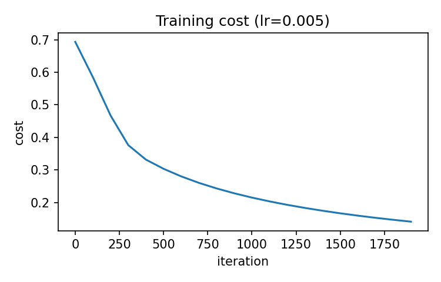
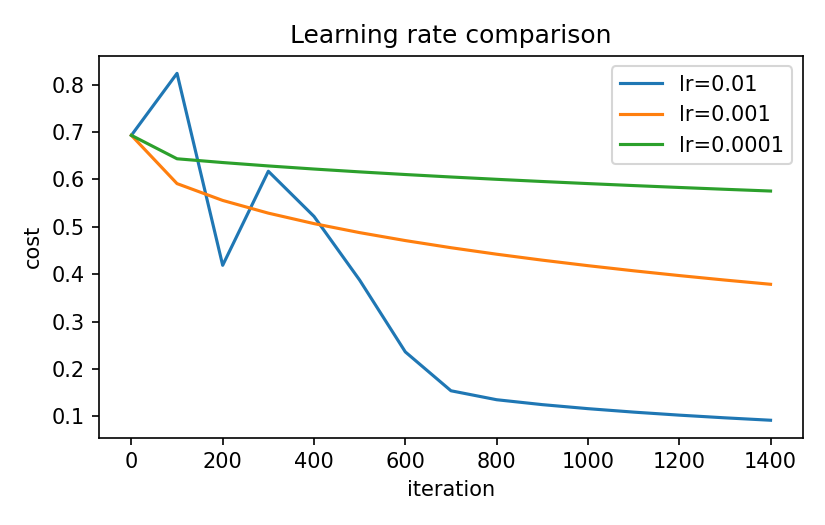
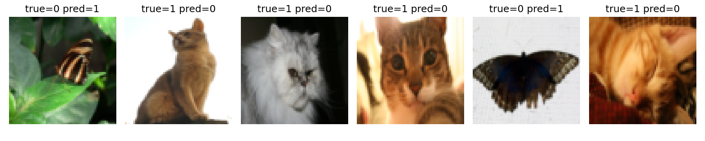

# Logistic regression from scratch (NumPy)

Binary image classifier (cat vs non-cat) built as a single-neuron network, with every
step written by hand: sigmoid, cost, gradients, gradient descent, prediction.

## What is inside

| File | Purpose |
|---|---|
| `model.py` | sigmoid, `propagate` (forward + backward), `optimize`, `predict`, `LogisticRegression` |
| `data.py` | dataset loaders and preprocessing (flatten, scale to [0, 1]) |
| `test_model.py` | unit tests for sigmoid, initialization, initial cost and training on toy data |
| `logistic_regression.ipynb` | experiments: baseline, learning-rate comparison, error analysis |
| `../assets/` | plots used below |

## Run

The Python modules are developed and tested locally; the notebook is run in Google
Colab, kept uniform with later labs that need a GPU — this notebook itself runs fine
on CPU.

### In Colab

```python
!git clone https://github.com/nyawmolny/deep-learning-fundamentals.git
%cd deep-learning-fundamentals/01-foundations/logistic-regression/numpy
```

Then open `logistic_regression.ipynb` and run all cells. Colab ships with numpy,
matplotlib and h5py, so the notebook runs as-is. `pytest` is not preinstalled in
Colab — run the tests locally.

> The `.h5` data files are not tracked by git. See the notebook for how they are
> mounted from Google Drive, or set `DATA_SOURCE = "cifar10"` to download CIFAR-10
> automatically.

### Locally

From this directory:

```bash
pip install -r requirements.txt
pytest
jupyter notebook logistic_regression.ipynb
```

Data: set `DATA_SOURCE` in the notebook to `"h5"` (put the files in `data/`, not
tracked by git) or `"cifar10"` (downloaded automatically).

## Results

Dataset: 209 train / 50 test images, 64x64x3 (12288 features).

| Learning rate | Iterations | Train acc. | Test acc. |
|---|---|---|---|
| 0.005 (baseline) | 2000 | 99.0% | 70.0% |
| 0.01 | 1500 | 99.5% | 68.0% |
| 0.001 | 1500 | 89.0% | 64.0% |
| 0.0001 | 1500 | 68.4% | 36.0% |





## Takeaways

- **Overfitting:** 12288 weights and only 209 training images let the model almost
  memorize the training set (99% train), while a linear classifier on raw pixels
  generalizes poorly (70% test).
- **Learning rate:** lr=0.01 converges faster, but its test accuracy is about the same
  as the baseline (68% vs 70%, one image out of 50), so this test set is too small to
  say which is better. lr=0.001 and lr=0.0001 had not converged in 1500 iterations and
  underfit. The baseline ran 2000 iterations, so the comparison is not fully controlled.
- **Errors:** the model sometimes misses cats and sometimes labels other objects
  (e.g. a butterfly) as cats.
- **Next:** L2 regularization should shrink the weights and reduce the train/test gap;
  a hidden layer or a CNN should capture shape better than a linear model on pixels. 