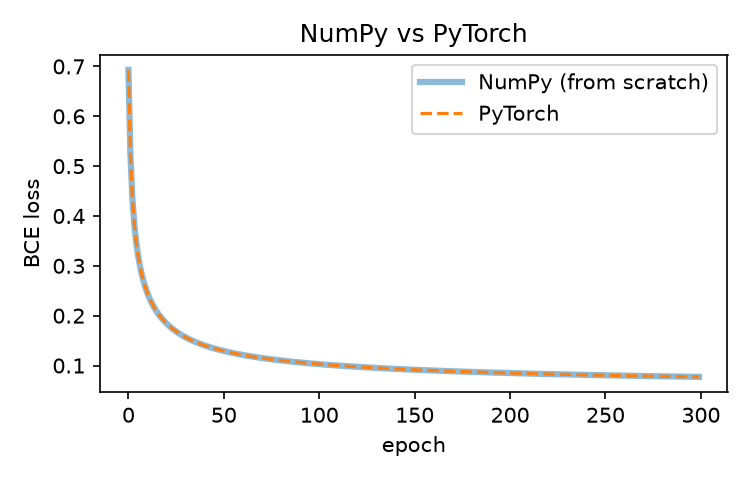

# Logistic regression in PyTorch

The model from the NumPy lab rebuilt with `nn.Linear` + sigmoid, `BCELoss` and `torch.optim`,
trained on the breast cancer dataset (0 = malignant, 1 = benign).

## What is inside

| File | Purpose |
|---|---|
| `model.py` | `LogisticRegressionTorch`, training loop, evaluation helpers, loader for the NumPy reference |
| `data.py` | split, standardization, majority baseline, tensor conversion |
| `test_data.py` | tests for the data pipeline |
| `test_model.py` | model tests and a **NumPy vs PyTorch equivalence test** |
| `logistic_regression_pytorch.ipynb` | experiments: verification, learning rate |
| `../assets/` | plots used below |

## Run

### Google Colab

```python
!git clone https://github.com/nyawmolny/deep-learning-fundamentals.git
%cd deep-learning-fundamentals/01-foundations/logistic-regression/pytorch
```

### Local (conda)

```bash
conda create -n env_name python=3.11 -y
conda activate env_name
conda install pytorch scikit-learn matplotlib pytest -c pytorch -c conda-forge -y
pytest
```

### Local (pip / venv)

```bash
python -m venv .venv && source .venv/bin/activate
pip install torch scikit-learn pytest matplotlib
pytest
```

## Results

Dataset: 455 train / 114 test examples, 30 features; majority-class baseline 58.8%.

| Setting | Train acc. | Test acc. |
|---|---|---|
| SGD, lr=0.01, 1000 epochs | 97.6% | 95.6% |

Verification against the from-scratch NumPy model (zero init, lr=0.1, 300 epochs, float64):
max loss difference 1.7e-15, max weight difference 1.8e-14.



## Takeaways

- NumPy and PyTorch agree to ~1e-15 in float64, so the hand-written gradients and the autograd ones are numerically identical.
- Learning rate: 0.001 underfits, 0.01 is the sweet spot, 0.1 and 1.0 only widen the train–test gap without improving test accuracy.
