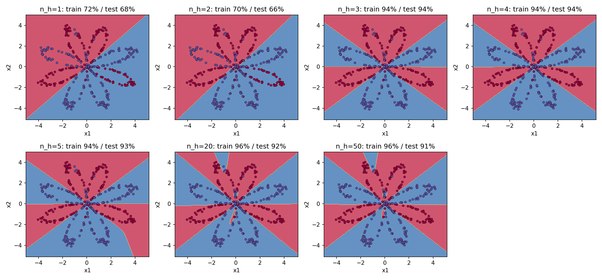

# Neural network with one hidden layer (NumPy)

Binary classifier for 2-D planar data: tanh hidden layer, sigmoid output, forward and
backward propagation and gradient descent written by hand.

## What is inside

| File | Purpose |
|---|---|
| `model.py` | initialization, forward/backward propagation, cost, update, `ShallowNetwork` |
| `data.py` | synthetic datasets (flower, moons, circles) and decision-boundary plot |
| `test_model.py` | shape tests |
| `test_data.py` | unit tests for data loaders |
| `shallow_network.ipynb` | experiments: linear baseline, hidden size sweep, other datasets |
| `../assets/` | plots used below |

## Run

The Python modules are developed and tested locally; the notebook is run in Google
Colab.

### In Colab

```python
!git clone https://github.com/nyawmolny/deep-learning-fundamentals.git
%cd deep-learning-fundamentals/01-foundations/shallow-network/numpy
```

### Locally

From this directory:

```bash
pip install -r requirements.txt
pytest
jupyter notebook shallow_network.ipynb
```

## Results

Flower dataset: 400 train / 200 test points.

| Model | Iterations | Train acc. | Test acc. |
|---|---|---|---|
| Logistic regression (sklearn) | lbfgs (default) | 52.8% | 47.0% |
| Network, n_h=4 | 5000 | 93.5% | 93.5% |
| Network, n_h=4 | 10000 | 94.5% | 93.0% |



## Takeaways

- A linear model (logistic regression) is at chance level: 52.8% train / 47.0% test.
  The two flower classes are not linearly separable, so no linear boundary can do better.
- One hidden layer with a nonlinear activation (tanh) turns the model into a nonlinear
  classifier. With only 4 hidden units and 10000 iterations it reaches 94.5% train / 93.0% test.
- Hidden size sweep (1, 2, 3, 4, 5, 20, 50 units, 5000 iterations each; the n_h=4 result
  here, 93.5% / 93.5%, differs slightly from the 10000-iteration run above):
  * n_h=1-2 **underfit**: train ~71% / test ~66%, both errors high.
  * n_h=3-4 are enough: 93.5% / 93.5%, train/test gap = 0.
  * n_h=20-50 show mild **overfitting**: train rises to 96.5% / 95.5%, test falls to
    92.0% / 91.0%, gap grows to 4.5 p.p. The 92% vs 91% difference at the largest sizes is
    ~2 test points out of 200 and is within noise; the trend 4 → 20 → 50 is what matters.

PyTorch version: see deep-network/pytorch, which supports any number of hidden layers.