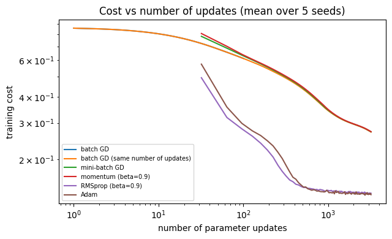
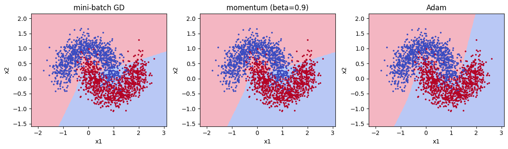

# Optimization methods from scratch (NumPy)

Gradient descent (batch and mini-batch), momentum, RMSprop and Adam implemented by hand and used to train
the same small ReLU network on a noisy moons problem, plus a short check of the optimizers against `torch.optim`.

## What is inside

| File | Purpose |
|---|---|
| `optimizers.py` | `GradientDescent`, `Momentum`, `RMSprop`, `Adam` with `step(params, grads)` |
| `model.py` | small L-layer ReLU network, `random_mini_batches`, training loop (batch or mini-batch) |
| `data.py` | moons dataset (scikit-learn) and decision-boundary plot |
| `test_optimizers.py` | every update rule against a hand-written formula, mini-batch coverage and reproducibility, training sanity checks |
| `test_torch.py` | the four optimizers against `torch.optim` |
| `optimization.ipynb` | experiments: optimizer comparison, learning-rate sensitivity, decision boundaries |
| `optimization_pytorch.ipynb` | short check of the optimizers against `torch.optim` |
| `assets/` | plots used below |

## Run

The notebooks were run in Google Colab; the code is developed locally and pulled into Colab.

```python
!git clone https://github.com/nyawmolny/deep-learning-fundamentals.git
%cd deep-learning-fundamentals/02-regularization-and-optimization/optimization
```

Tests locally, from this directory:

```bash
pip install numpy scikit-learn matplotlib pytest torch
pytest
```

## Results

Network `[2, 10, 5, 1]`, learning rate 0.01, 100 epochs, mini-batch size 64, 2000 train / 1000 test points,
mean ± std over 5 seeds.

| Optimizer | Updates | Train acc. | Test acc. |
|---|---|---|---|
| Batch GD | 100 | 62.3 ± 21.3 | 61.5 ± 20.3 |
| Batch GD (same number of updates) | 3200 | 88.7 ± 0.9 | 88.3 ± 0.8 |
| Mini-batch GD | 3200 | 88.8 ± 0.8 | 88.3 ± 0.8 |
| Momentum | 3200 | 88.7 ± 0.8 | 88.1 ± 0.9 |
| RMSprop | 3200 | 94.7 ± 0.3 | 93.5 ± 0.5 |
| Adam | 3200 | 94.9 ± 0.1 | 93.7 ± 0.2 |




Check against PyTorch: max parameter difference 5.6e-17 (update rules), max cost difference 8.9e-16 (full training).

## Takeaways

- **Batch vs mini-batch.** Batch GD at 100 updates (61.5% test) lags mini-batch GD (88.3%) only because it makes 32× fewer updates at the same lr and has not converged; the large std reflects early-training spread. At 3200 updates the two are indistinguishable (88.3% each). Mini-batching buys cheaper steps and more updates per epoch, not better final accuracy.

- **Momentum, RMSprop and Adam at the same lr.** Momentum (88.1%) is indistinguishable from plain mini-batch GD (88.3%): nothing to accelerate on this smooth problem. RMSprop (93.5%) and Adam (93.7%) clearly beat GD (88.3%), intervals do not overlap, so per-parameter step adaptation makes a small lr effective. Adam vs RMSprop overlaps.

- **Learning-rate sensitivity.** Mini-batch GD catches up: 84.7% at lr 0.003 and 93.4% at lr 0.1. Adam shows the opposite trend (94.0% and 92.5% at lr 0.003 and 0.3), because it already adapts per-parameter steps. Adam widens the usable lr range rather than raising the best accuracy (0.6 pp higher on this coarse grid).

- **PyTorch check.** All four from-scratch optimizers match `torch.optim` to float64 precision (~1e-16 max parameter difference after 50 steps; at most 8.9e-16 end-to-end cost over 200 epochs). Momentum needs `lr * (1 - beta)` in PyTorch because `buf = beta*buf + g` differs by that factor from the from-scratch `v = beta*v + (1-beta)*g`.
