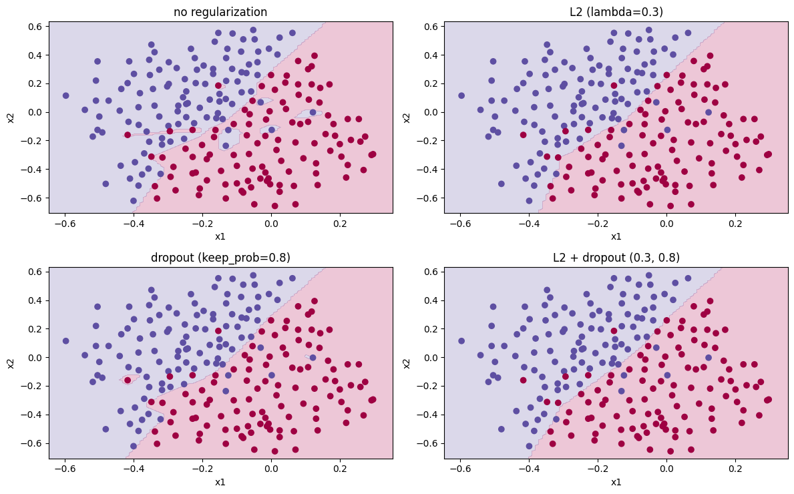
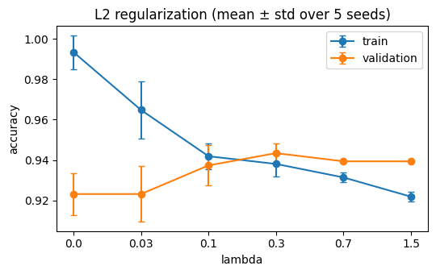
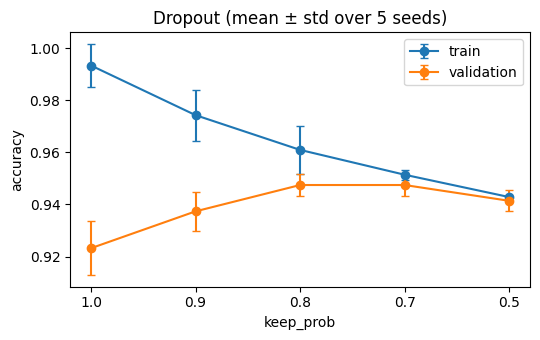

# Regularization: L2 and dropout from scratch (NumPy)

A 3-layer ReLU network with L2 regularization and inverted dropout, written by hand, on the
"football" problem: given where the goalkeeper's kick lands, which team gets the ball?
With only 211 training points the unregularized network can memorize the training set.

## What is inside

| File | Purpose |
|---|---|
| `model.py` | He init, forward/backward propagation with L2 and dropout, `RegularizedNetwork` |
| `data.py` | CSV loader for the football dataset, data and decision-boundary plots |
| `test_model.py` | model tests |
| `regularization.ipynb` | experiments: baseline, L2 sweep, dropout sweep, final comparison |
| `regularization_pytorch.ipynb` | the same problem with PyTorch built-ins: `weight_decay`, `nn.Dropout`, `train()` / `eval()` |
| `assets/` | plots used below |

## Data

Football dataset: 2-D (normalized) coordinates of where the goalkeeper's kick lands, the label says which team gets
the ball. The notebooks load 210 training points (`train.csv`) and 199 held-out points (`val.csv`). The files are not
tracked by git: they are kept on Google Drive (or put them in a `data/` folder next to the notebooks).

## Run

The notebooks were run in Google Colab; the code is developed locally and pulled into Colab.

```python
# first cells in Colab
from google.colab import drive
drive.mount("/content/drive")
!git clone https://github.com/nyawmolny/deep-learning-fundamentals.git
%cd deep-learning-fundamentals/02-regularization-and-optimization/regularization
```

The setup cells of the notebooks point to the data on Drive and to the folder for plots.

Tests locally, from this directory:

```bash
pip install numpy pandas matplotlib pytest
pytest
```

The PyTorch notebook additionally needs `torch` (preinstalled in Colab).

## Protocol

The data ship as train and val only, so `val.csv` is split into a validation half (99 points, used to choose
hyperparameters) and a test half (100 points, final report only), stratified with a fixed seed. One test example is
1 percentage point. Every setting is run with 5 random seeds (mean ± std).

## Results

Sizes: 210 train / 99 validation / 100 test; majority-class baseline on test: 44.0%.
Hyperparameters were chosen on the validation half (lambda = 0.3, keep_prob = 0.8). Mean ± std over 5 seeds.

| Setting | Train acc. | Test acc. |
|---|---|---|
| No regularization | 99.3 ± 0.8 | 91.4 ± 1.0 |
| L2 (lambda = 0.3) | 93.8 ± 0.6 | 93.4 ± 1.4 |
| Dropout (keep_prob = 0.8) | 96.1 ± 0.9 | 92.8 ± 0.7 |
| L2 + dropout | 94.2 ± 0.2 | 92.2 ± 0.4 |





## Takeaways

- **Baseline overfits:** 99.3% train vs 91.4% test (gap 7.9 pp, far above the 0.8-1.0 pp seed spread). The decision boundary follows individual noisy points instead of the overall pattern.

- **L2:** the weight norm drops from 29.3 to 8.4 at lambda = 0.3, and the train/test gap shrinks to 0.4 pp (93.8% / 93.4%). Validation accuracy rises from 92.3% to 94.3% and test from 91.4% to 93.4%. The test gain is larger than the seed spread (1.0-1.4 pp), but the test set has only 100 points, so the exact size of the gain is uncertain.

- **Dropout:** keep_prob 0.8 and 0.7 tie on validation (94.7 ± 0.4). With 0.8 the gap shrinks to 3.3 pp (96.1% / 92.8%), less than with L2. The test gain over the baseline (+1.4 pp) is close to the seed spread, so it is not clearly different from the baseline. L2 + dropout (92.2% test) is not better than either alone.

- **PyTorch:** `SGD(weight_decay=lambd/m)` reproduces the from-scratch L2 (max weight difference 4.4e-16 after 300 steps), and `nn.Dropout` is active only in `train()` mode (two calls differ in train mode, identical in eval mode). With the same hyperparameters the PyTorch run shows the same pattern (L2 best: 95.6% test vs 93.2% without regularization).
